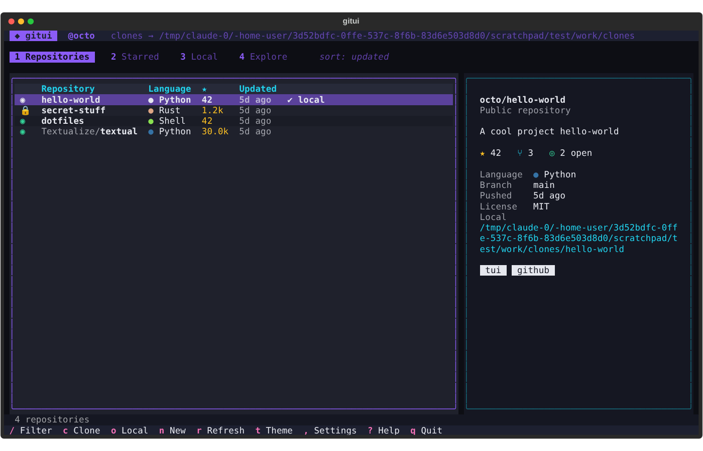

# ◆ gitui

**A sleek, keyboard-only GitHub client that runs entirely inside your terminal.**
Built for headless machines like the Raspberry Pi 5: it never opens a browser or a window.
Sign-in happens with a short code and a QR code that you scan on your phone.



---

## Contents

- [Features](#features)
- [Quick start (Raspberry Pi 5 / any Linux)](#quick-start-raspberry-pi-5--any-linux)
- [Signing in (one time only)](#signing-in-one-time-only)
- [Enabling "Sign in with GitHub" (phone/QR sign-in)](#enabling-sign-in-with-github-phoneqr-sign-in)
- [Using gitui](#using-gitui)
- [Keyboard reference](#keyboard-reference)
- [Themes](#themes)
- [Where things are stored](#where-things-are-stored)
- [Updating & uninstalling](#updating--uninstalling)
- [Troubleshooting](#troubleshooting)
- [Project layout](#project-layout)
- [Development](#development)

---

## Features

| Area | What you can do |
|---|---|
| **Sign-in** | Sign in once and stay signed in. Choose phone/QR device-code sign-in, a personal access token, or reuse an existing `gh` CLI login. |
| **Repositories** | Browse your own, collaborator and organization repos in one table with language, stars, visibility, last push and a "✔ local" marker. Filter as you type and sort by updated, name or stars. A detail side panel shows the selected repo. |
| **Starred / Explore** | Browse your starred repos, or search all of GitHub (supports qualifiers like `language:rust stars:>100`). |
| **Repo view** | Read the README rendered as Markdown. Tabs for Issues, Pull Requests, Branches, Commits and Releases. |
| **Issues & PRs** | Read the body and comments, comment, close or reopen, open new issues, and merge PRs (merge, squash or rebase). |
| **Clone** | One key. A live progress dialog shows git's own progress. Clones go to `~/github/<repo>` (configurable). |
| **Local repos** | Stage and unstage per file, stage everything, view a coloured diff, discard, commit, **push** (sets upstream automatically), **pull**, fetch, stash and pop. Log with a commit preview, plus branch switch, create and delete. |
| **Repo management** | Create a new repo (private/public, README, auto-clone), fork, star or unstar, and delete (you must type the full name to confirm). |
| **Links** | Any "open on GitHub" action shows the URL **and a QR code** inside the terminal. Nothing launches. |
| **Looks** | 5 custom themes plus ~20 built-in ones (Tokyo Night, Catppuccin, Nord, Dracula, Gruvbox…). The picker shows each theme live and remembers your choice. |
| **Input** | 100% keyboard. The mouse is disabled on purpose. |

Screenshots: [repo](docs/03_repo.png) · [issue](docs/05_issue.png) · [local changes](docs/07_local.png) · [log](docs/09_log.png) · [themes](docs/11_theme.png) · [link + QR](docs/12_link.png) · [phone sign-in](docs/30_device.png)

---

## Quick start (Raspberry Pi 5 / any Linux)

Requirements: **Python 3.9+**, **git** and an internet connection. Raspberry Pi OS Bookworm and Trixie already have everything; the installer adds anything missing with `apt`.

```bash
git clone https://github.com/skhshths/gitui.git ~/gitui
```

```bash
cd ~/gitui && ./install.sh
```

Then open a **new terminal** (or run `source ~/.bashrc`) and type:

```bash
gitui
```

That's it. What the installer does:

1. Installs `git`, `python3` and `python3-venv` with `apt` if any are missing (asks for your sudo password only in that case).
2. Creates an isolated Python environment in `~/.local/share/gitui/venv`, so nothing touches your system Python.
3. Installs the three dependencies: [Textual](https://textual.textualize.io/) (the TUI framework), [httpx](https://www.python-httpx.org/) (HTTP) and [qrcode](https://pypi.org/project/qrcode/) (terminal QR codes).
4. Links the `gitui` command into `~/.local/bin`, and adds that folder to your `PATH` in `~/.bashrc` (and `~/.zshrc` if you use zsh).

### Command-line options

| Command | What it does |
|---|---|
| `gitui` | Open the dashboard (or the sign-in screen the first time). |
| `gitui .` | Open the git repository in the current folder straight in the local view. Any path works, e.g. `gitui ~/github/myrepo`. |
| `gitui --logout` | Forget the saved sign-in and exit. |
| `gitui --version` | Print the version. |

---

## Signing in (one time only)

The first launch shows the sign-in screen. Pick a method with `↑`/`↓` and press `enter`:

| Method | Best for | What happens |
|---|---|---|
| 📱 **Sign in with GitHub** | Headless Pi, nicest experience | gitui shows a code like `WDJB-MJHT` and a QR code. Scan it with your phone (or open `github.com/login/device` anywhere), enter the code and approve. gitui picks it up automatically. **Needs a one-time setup**, see the next section. |
| ⚡ **Use my GitHub CLI login** | You already ran `gh auth login` | Reuses the `gh` token. Only shown if `gh` is installed. |
| 🔑 **Paste a personal access token** | Works with zero setup | gitui shows a link and QR code to GitHub's token page with the right scopes pre-ticked. Create the token on your phone or PC, then paste it in. |

Your token is saved in `~/.config/gitui/config.json` with `0600` permissions (readable only by you), so **you never sign in again** unless you sign out or revoke the token.

**Token scopes used:** `repo` (private repos, push), `read:org` (organization repos), `workflow` (pushing changes to `.github/workflows`), `delete_repo` (only needed for the delete action) and `gist`.

> **Fine-grained tokens** also work. Give them access to the repositories you want, with *Contents: read/write*, *Issues: read/write*, *Pull requests: read/write*, *Metadata: read* and *Administration: read/write* (for create/delete).

---

## Enabling "Sign in with GitHub" (phone/QR sign-in)

GitHub's device sign-in has to be tied to an "OAuth App". This takes about 1 minute, once, and needs **no secret**: a client ID is public information.

1. On any device, go to **GitHub → Settings → Developer settings → OAuth Apps → New OAuth App** (direct link: `https://github.com/settings/applications/new`).
2. Fill in:
   - **Application name:** `gitui` (anything)
   - **Homepage URL:** `https://github.com/skhshths/gitui`
   - **Authorization callback URL:** `http://localhost` (not used, but required)
3. Click **Register application**, then tick **✅ Enable Device Flow** and **Update application**.
4. Copy the **Client ID** (it looks like `Ov23li…`).

Then use **any one** of these:

- **Easiest:** choose "Sign in with GitHub" in gitui. It asks for the client ID once and remembers it.
- **For everyone who clones your repo:** paste it into `gitui/config.py`:
  ```python
  DEFAULT_CLIENT_ID = "Ov23liXXXXXXXXXXXXXX"
  ```
  Commit and push it. Every install of your repo can then use phone sign-in with zero setup.
- **Per machine via environment variable:** `export GITUI_CLIENT_ID=Ov23li…`

---

## Using gitui

### Dashboard

- `1` **Repositories**: everything you own or can access, newest push first.
- `2` **Starred**
- `3` **Local**: every git repo inside your clone folder (`~/github` by default), with its branch, clean/dirty state and ahead/behind counts.
- `4` **Explore**: search all of GitHub. Press `/`, type a query, then press `enter`.

Move with `↑↓` or `j k` and press `enter` to open. Press `/` to filter live and `esc` to clear the filter.

### Typical workflow on the Pi

1. `gitui`, select your repo, press `c` to **clone** it (with a live progress bar).
2. Edit files with your editor of choice (`nano`, `vim`…).
3. `gitui .` inside the folder, or `3` (Local) then `enter`.
4. Press `space` to stage a file (or `a` for all), then `c` to **commit**. Write the message, then press `ctrl+s`.
5. Press `p` to **push**. A new branch gets its upstream set automatically.

If git has no `user.name`/`user.email` configured, gitui sets them **for that repository only**, using your GitHub name and your private `noreply` address. Your global git config is never changed.

### Repository view

Tabs: `1` Overview (README), `2` Issues, `3` Pull requests, `4` Branches, `5` Commits, `6` Releases. You can also switch tabs with `← →` or `h l`.
In Issues/PRs, `a` cycles open → closed → all, and `enter` opens one.

### Issue / PR view

`m` comment · `x` close/reopen · `M` merge (PRs) · `w` link + QR · `j k` scroll.
In text editors (new issue, comment, commit message), `tab` moves between fields, `ctrl+s` submits and `esc` cancels.

---

## Keyboard reference

Press `?` on any screen to see its shortcuts.

**Global:** `t` theme · `,` settings · `?` help · `q` quit (dashboard) · `ctrl+q` quit from anywhere · `esc` back / cancel

**Dashboard**

| Key | Action | | Key | Action |
|---|---|---|---|---|
| `1`–`4` / `tab` | switch section | | `c` | clone |
| `↑↓` `j k` `g G` | move / top / bottom | | `o` | open local clone |
| `enter` | open repo | | `O` | open any folder by path |
| `/` | filter / search | | `n` | new repository |
| `s` | cycle sort | | `*` | star / unstar |
| `r` | refresh | | `f` | fork |
| `w` | link + QR | | `D` | delete (type name to confirm) |
| `y` | copy clone URL | | | |

**Local repository**

| Key | Action | | Key | Action |
|---|---|---|---|---|
| `1` `2` `3` | Changes / Log / Branches | | `p` | push |
| `space` / `enter` | stage ↔ unstage (Branches: checkout) | | `P` | pull |
| `a` / `A` | stage all / unstage all | | `f` | fetch all |
| `d` | discard file changes | | `b` | new branch |
| `c` | commit | | `D` | delete branch |
| `z` / `Z` | stash / pop | | `r` | refresh |

---

## Themes

Press `t`. Moving through the list **previews each theme live**. `enter` keeps it (saved for next time) and `esc` reverts.

Custom themes: **gitui** (violet, default), **gitui-ocean**, **gitui-ember**, **gitui-matrix** and **gitui-paper** (light).
Built-in: Tokyo Night, Catppuccin (4 flavours), Nord, Dracula, Gruvbox, Monokai, Rosé Pine, Solarized, Flexoki, Atom One and more.

To add your own theme, append a `Theme(...)` to `THEMES` in `gitui/ui.py`.

> For the best colours use a terminal with true-colour support. The Raspberry Pi OS terminal, GNOME Terminal, kitty, WezTerm, Windows Terminal and iTerm2 over SSH all work. gitui also runs on the bare Linux console (`ctrl+alt+F2`) with reduced colours.

---

## Where things are stored

| What | Path |
|---|---|
| Sign-in token + settings | `~/.config/gitui/config.json` (mode `0600`) |
| App + Python environment | `~/.local/share/gitui/venv` |
| Launcher | `~/.local/bin/gitui` |
| Clones (default) | `~/github/<repo-name>` (change it in Settings with `,`) |

**How git authentication works:** for HTTPS GitHub remotes, gitui passes your token to git **per command** through a temporary credential helper limited to `github.com`, using an environment variable. The token is **never written** into `.git/config`, remote URLs, or your global git config. SSH remotes keep using your SSH keys as usual.

---

## Updating & uninstalling

**Update:**

```bash
cd ~/gitui && git pull && ./install.sh
```

**Uninstall** (keeps your sign-in and clones):

```bash
~/gitui/uninstall.sh
```

**Uninstall and forget the sign-in:**

```bash
~/gitui/uninstall.sh --purge
```

To also revoke access on GitHub: for a token, go to *Settings → Developer settings → Personal access tokens*; for the OAuth app, go to *Settings → Applications → Authorized OAuth Apps*.

---

## Troubleshooting

| Problem | Fix |
|---|---|
| `gitui: command not found` | Open a new terminal or run `source ~/.bashrc`. Check with `ls ~/.local/bin/gitui`. |
| A different "gitui" starts (e.g. the Rust git tool from `apt`) | The installer puts `~/.local/bin` first in `PATH`. Open a new shell, check with `type gitui`, or remove the other one with `sudo apt remove gitui`. |
| "Unknown client ID" / "Device flow is disabled" | Re-check the client ID, and make sure **Enable Device Flow** is ticked in the OAuth App. Or use the token method. |
| Push fails with 403 | The token lacks the `repo` scope, or `workflow` for changes to `.github/workflows`. Sign out (`,` → Sign out) and sign in with a new token. |
| Delete says "needs delete_repo scope" | Create a token with `delete_repo`, or delete the repo on the website. |
| Private org repos missing | The organization may restrict OAuth apps. Approve gitui in the org settings, or use a token. |
| Colours look wrong | Use a true-colour terminal and try `export COLORTERM=truecolor`. |
| `ctrl+s` freezes the terminal | Rare (XON/XOFF flow control). Press `ctrl+q` to unfreeze. `ctrl+d` also submits in text dialogs. |
| Install fails at pip | See `~/.local/share/gitui/install.log`. Usually a network issue: rerun `./install.sh`. |

---

## Project layout

```
gitui/
├── install.sh / uninstall.sh   one-command install & removal
├── pyproject.toml              package metadata, `gitui` entry point
├── docs/                       screenshots
└── gitui/
    ├── app.py                  App class, CLI args, session restore, sign-out
    ├── config.py               config file (0600), OAuth client ID, scopes
    ├── github.py               async GitHub REST client + device-flow auth
    ├── gitops.py               async git wrapper (status, diff, commit, push…)
    ├── ui.py                   themes, formatting, QR + diff rendering
    ├── styles.tcss             all styling (uses theme variables)
    └── screens/
        ├── login.py            first-run sign-in (QR / gh / token)
        ├── dashboard.py        repos / starred / local / explore
        ├── repo.py             README, issues, PRs, branches, commits, releases
        ├── issue.py            issue/PR detail, comments, merge
        ├── local.py            stage, diff, commit, push/pull, log, branches
        └── dialogs.py          confirm, input, editor, theme, QR link, git progress
```

## Development

```bash
python3 -m venv .venv
```

```bash
.venv/bin/pip install -e .
```

```bash
.venv/bin/gitui
```

To see live logs and inspect widgets, use Textual's dev tools:

```bash
.venv/bin/pip install textual-dev
```

```bash
.venv/bin/textual run --dev gitui.app:GitUI
```

## License

MIT. See [LICENSE](LICENSE).
